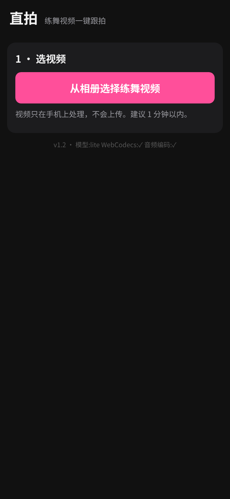
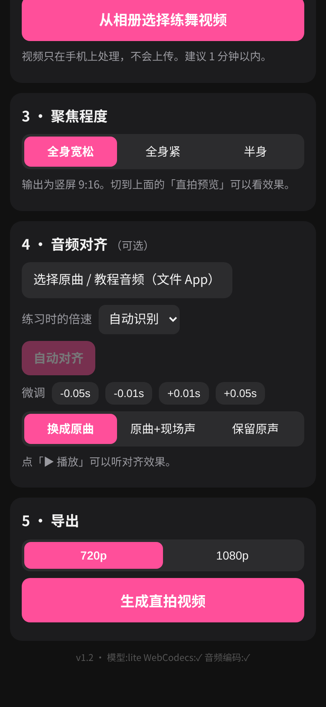

# 直拍 · Zhipai

**练舞视频一键跟拍**：从多人练舞视频里，点一下自己，自动生成跟着你走的竖屏直拍。所有处理都在手机浏览器里完成，视频不会上传。

👉 在线使用：**https://cassie19-jpg.github.io/zhipai/**

> **English summary** — Zhipai is a privacy-first PWA that turns a group dance-practice video into a vertical 9:16 "focus cam" of one dancer. Tap yourself once; on-device person detection (MediaPipe, WASM) tracks you through the clip, a smoothed virtual camera crops the frame, and the result is exported as an MP4 (720p/1080p) via WebCodecs. Optionally align the original song (auto speed detection, pitch-preserving time-stretch). Everything runs locally in the browser — nothing is uploaded. Built for iPhone Safari; UI in Chinese. MIT licensed.

<p>
  
  
</p>

## 功能

- **点一下就跟拍**：画面里 2–5 个人也没问题。暂停后点自己，App 自动在整段视频里找到你。中途跟错了，拖到那一刻再点一下就能纠正（可撤销）。只有一个人时自动选中。
- **三档聚焦**：全身宽松 / 全身紧 / 半身，输出竖屏 9:16，镜头平滑不抖。
- **音频对齐（可选）**：导入原曲或教程音频，自动对齐开头；支持练习时的倍速（自动识别，或手动选 0.5x–1.0x / 自定义），**变速不变调**；可 ±0.01s 微调；输出声音可选「换成原曲 / 原曲+现场声 / 保留原声」。
- **导出 720p / 1080p MP4**（H.264 + AAC），通过 iOS 分享菜单「存储视频」直接存进相册。1080p 在内存不够的设备上会自动降级重试。
- **完全本地、保护隐私**：识别、剪裁、编码都在你的手机上完成，视频不出设备。模型和 wasm 文件随网页一起托管，不依赖海外 CDN。
- **PWA**：可添加到主屏幕，像 App 一样打开；模型首次下载后会缓存。

## 在 iPhone 上使用

1. 用 **Safari** 打开 https://cassie19-jpg.github.io/zhipai/
2. 点分享按钮 →「添加到主屏幕」（可选，之后像 App 一样打开）
3. **选视频**：从相册选练舞视频（建议 1 分钟以内），等它分析完（处理时保持页面在前台、不要锁屏）
4. **点自己**：暂停后点画面里的你，粉色框就是正在跟的人；切到「直拍预览」看效果
5. **选聚焦程度**，需要的话**导入原曲**并点「自动对齐」
6. 点「**生成直拍视频**」→「**保存到相册**」→ 选「存储视频」

建议系统：iOS 17 及以上（音频编码需要 iOS 26+；更老的系统会用实时录制的兜底方式导出，较慢）。

## 技术栈

- **人物检测**：[MediaPipe Tasks Vision](https://github.com/google-ai-edge/mediapipe)（WASM / CPU）— EfficientDet-Lite0 找出所有人（横屏视频分块检测，后排的人也能找到），Pose Landmarker 提供肩、胯关键点用于半身构图
- **跟踪**：把每帧检测框连成一条路径的全局动态规划（Viterbi），综合位移、尺寸变化、遮挡跳帧和衣服颜色直方图；用户的每次点选都是强制经过的锚点
- **虚拟镜头**：按聚焦档位计算 9:16 裁切框，零延迟高斯平滑
- **音频**：谱通量起音包络 + FFT 归一化互相关，搜索倍速和偏移；WSOLA 时间伸缩（保持音调）
- **视频读写**：[Mediabunny](https://github.com/Vanilagy/mediabunny) + WebCodecs（解码、H.264/AAC 编码、MP4 封装），无 WebCodecs 时回退到 MediaRecorder
- 纯静态网页，无构建步骤、无后端；托管在 GitHub Pages

```
index.html  style.css  sw.js  manifest.webmanifest
js/app.js     界面、识别、预览、导出
js/track.js   跟踪（动态规划）与镜头路径
js/audio.js   音频对齐与 WSOLA 变速
vendor/       MediaPipe、Mediabunny（第三方，未修改）
models/       姿态与人物检测模型
```

本地运行：在仓库根目录起一个静态服务器即可（例如 `python3 -m http.server`），用 `localhost` 打开；手机访问需要 HTTPS。

## 已知限制

- 两个人衣服很像又交叉换位、或长时间被挡住时，仍可能跟错；App 会标出可疑的时刻，在那一刻再点一下自己即可纠正
- 暂停时的直拍预览清晰度较低，播放和导出是高清的
- 分析速度取决于手机性能，30 秒视频大约半分钟到一分钟
- 倍速自动识别范围 0.5x–1.3x；原曲和视频里的版本不同时对齐可能不准（会显示可信度）
- 目前只针对 iPhone Safari 做了适配和测试

## 路线图

- [ ] 一键保存到 Notion 的每日练舞复盘
- [ ] 更快的分析（GPU 加速）
- [ ] 更多导出画幅

## 更新日志

- **v1.3**（2026-10-12）跟拍更稳：身份锁定（画面里看不到你时宁可原地等，也不轻易换到别人身上，最长等 10 秒）；不会“接管”旁边一直可见的人（镜子倒影、拍摄者、旁边的同学）；加入运动惯性，交叉换位时不容易跟错；点选画面的坐标映射改为严格等比；跟拍结果会列出“没找到你 / 旁边有很像的人”的时刻，点一下就能跳过去检查、再点一次纠正
- **v1.2** 修复部分 iPhone 上程序加载不出来的问题；加载失败时显示原因和「重新加载」按钮
- **v1.1** 修复 iPhone 上导出画面比例变形；1080p 导出失败时自动降级重试
- **v1.0** 首个版本

## 许可证

本项目代码采用 [MIT](LICENSE) 协议。随附的第三方组件（MediaPipe 模型与 wasm：Apache-2.0；Mediabunny：MPL-2.0）见 [THIRD_PARTY_NOTICES.md](THIRD_PARTY_NOTICES.md)。

---

Built with Grok Bot ⚫
